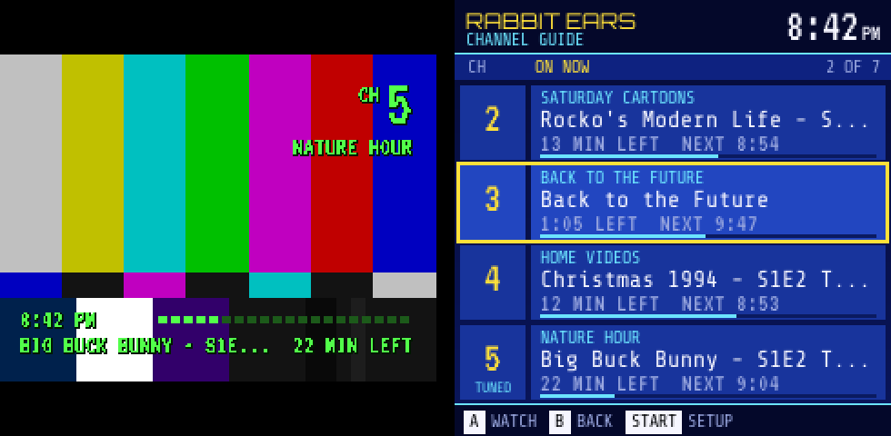

# Rabbit Ears for the RG Nano

A 90s TV set for the **Anbernic RG Nano** running **DrUm78's FunKey-OS**. Put videos on the SD card and they become channels: flip through them with the d-pad, through a burst of snow, with a green channel number in the corner. Every channel is always "on the air": tune in and you land mid-show based on the clock, the way TV used to work.

This is a port of [Rabbit Ears for OnionOS](https://github.com/snyderman3000/rabbitears) (Miyoo Mini / Mini Plus). The channels, commercials, DVR mode and the **vhsify** converter all work the same; the screens are redrawn for the Nano's 240×240 panel, and it brings its own video player, because DrUm78's OS doesn't have one.



> Built by Claude, Anthropic's AI model, for [snyderman3000](https://github.com/snyderman3000).
>
> **Status: test build.** It has been run end to end on a PC under ARM emulation, but not yet on a physical RG Nano. If something's off, please open an issue with `FunKey/RabbitEars/rabbitears.log` and `stderr.log` from your SD card.

## Install

1. Download `RabbitEars-vX.Y.Z-RGNano.zip` from Releases.
2. Copy its `Applications` and `Media` folders to the root of your SD card (merge with what's there).
3. Put channels in `Media/TV` (below) and open **Rabbit Ears** from Applications.

Settings, logs and DVR progress live in `FunKey/RabbitEars` on the card.

## Channels

| In `Media/TV` | Becomes |
|---|---|
| `Late Movie.mp4` | a channel that loops that video |
| `Saturday Cartoons/` | a channel that airs every video inside, then repeats |
| `Saturday Cartoons/Doug/Season 1/…`, `Saturday Cartoons/Rugrats/…` | show folders: the channel rotates between them one episode at a time (Doug 1, Rugrats 1, Doug 2 …); seasons stay in order, "Ep 2" before "Ep 10" |
| `07 MTV/` or `12 - Movie.mp4` | the leading number picks the channel; the rest count up from 2 |
| `Commercials/` | commercials for the breaks (below) |

Videos must be **MP4** (H.264 or MPEG-4 video, AAC or MP3 sound). The Nano has one 1.2 GHz core, so **convert with vhsify**: its 320×240 output plays smoothly and tunes in fast. Anything bigger than 1280×720 is refused.

Show order is set in **SETUP** (START): *rotate*, *in order* or *shuffle*. An `order.txt` in a channel folder containing `rotate`, `in order` or `shuffle` overrides it for that channel.

## Commercials

Put old commercials (MP4, up to 5 minutes) in `Media/TV/Commercials`. In live TV they play before every show and in breaks during it. A folder inside `Commercials` named after a channel (`Commercials/G4/`) is just for that channel; the rest are shared. SETUP turns them on or off and sets how often breaks come and how many commercials each break has. Breaks are part of the timetable, so the guide's times stay right.

## DVR mode

SETUP → MODE → DVR switches from live channels to on demand: browse channel → show → season → episode and watch anything from the start. Rabbit Ears remembers where you stopped, plays the next episode of the same show when one ends, and marks what you've watched.

## Picture

SETUP → PICTURE: **4:3** shows the whole picture with black bars above and below; **ZOOM** fills the square screen and cuts off the sides.

## Controls

| Live TV | |
|---|---|
| Up / Down, L / R, Left / Right | change channel |
| B | previous channel |
| A or Y | display: channel, show, clock, time left |
| X or SELECT | channel guide |
| START | SETUP |
| Power button | power menu: resume, turn the TV off, shut down |

| DVR list | |
|---|---|
| A | open / play (resume) |
| Y | play from the start |
| X | mark watched / unwatched |
| B | back |
| SELECT | live TV |
| START | SETUP |

| Watching a DVR episode | |
|---|---|
| Left / Right | −10 s / +10 s |
| Down / Up | −1 min / +1 min |
| L / R | −10 min / +10 min |
| A | pause |
| B or SELECT | stop, back to the list |

Volume and brightness stay on the OS's own FN combos. SETUP → TURN TV OFF also quits.

## vhsify

```sh
sudo apt install ffmpeg             # 4.4 or newer
chmod +x vhsify
./vhsify ~/Videos/Simpsons -o /media/$USER/SDCARD/Media/TV          # one channel
./vhsify --mirror ~/Videos/TV -o /media/$USER/SDCARD/Media/TV        # whole lineup
./vhsify --fill --wear 2 "Back to the Future.mkv" -o ~/tv            # crop to 4:3, more worn
```

Output is 320×240 H.264 baseline with a keyframe every second and 32 kHz mono AAC, about 180 MB an hour, with the VHS look baked in. `converter/` also has a Raspberry Pi drop-folder setup (Docker).

## How it works

| File | |
|---|---|
| `tvplay/tvplay.c` | the video player: FFmpeg decode → bilinear YUV to RGB565 straight into `/dev/fb0`, sound through ALSA's `default` device (so the OS's speaker routing, USB-C audio and volume keep working), audio-clocked sync, `-ss`/`-t`, the channel-number overlay, and DVR seeking with a small time bar |
| `tvplay/build.sh` | cross-builds tvplay as one static ARMv7 binary from FFmpeg 6.1.2 and alsa-lib 1.2.10 sources |
| `channels.go` | scans `Media/TV` and `Commercials`, reads MP4 lengths, orders shows, lays out each channel's timetable |
| `player.go` | runs tvplay, writes the overlay, reads back the DVR position |
| `screens_nano.go`, `screens.go`, `menu.go`, `dvr.go` | the 240×240 guide, SETUP, DVR, power menu, colour bars, snow and CRT power on/off |
| `device.go` | the RGB565 framebuffer and fkgpiod's buttons |
| `main.go` | the TV: input, tuning, auto-advance, the power button |

The power button sends the running app `SIGUSR1` and FunKey-OS powers off a tenth of a second later unless the app cancels it; Rabbit Ears cancels it and shows its own power menu, like GMenu2X and the emulators do.

```sh
./build.sh                  # tests + dist/RabbitEars-vX.Y.Z-RGNano.zip and RabbitEars.opk
go run . -shot guide        # osd | info | ad | play | zoom | guide | menu | dvr | dvr2 | upnext | power | bars | nosignal | snow | on | off
go run . -scan ~/tv         # print the lineup a folder would make
RABBITEARS_TVPLAY=./tvplay-under-qemu RABBITEARS_TESTVIDEO=clip.mp4 go test -run RealTvplay   # the real ARM player
```

MIT licensed (see [THIRD_PARTY_NOTICES.md](THIRD_PARTY_NOTICES.md)). Fonts: VT323, Share Tech Mono, Orbitron (SIL OFL 1.1). tvplay links FFmpeg and alsa-lib (LGPL-2.1).
